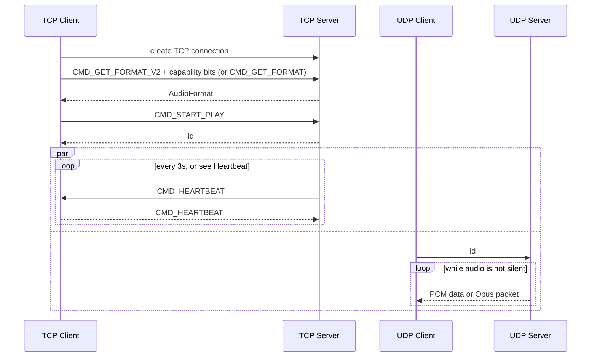

## Discovery (optional)

A server started with `--discovery` also listens on UDP port 65531 on every interface, so the app can find it without the address being typed in. This is separate from the audio connection and is off by default.

Request: a UDP datagram of at least 64 bytes sent to the broadcast address (`255.255.255.255` and the subnet broadcast address). The first four bytes are `ASDQ`, the rest is padding.

Reply: a unicast datagram back to the sender.

| Offset | Size | Meaning |
|---|---|---|
| 0 | 4 | `ASDR` |
| 4 | 1 | reply version, currently 1 |
| 5 | 2 | TCP port of the audio server, little-endian |
| 7 | 1 | name length in bytes, at most 48 |
| 8 | n | server name (the PC's host name, UTF-8) |

The client connects to the address the reply came from. Later versions may append fields, so ignore bytes past the name.

The server only answers sources on private or link-local networks. Replies are never longer than the 64-byte request, and at most about 100 are sent per second. If the server is bound to one address, it only answers requests that would leave from that address. Discovery is IPv4 broadcast only for now.

## Byte order

Every multi-byte integer on the wire (command ids, the length prefix before `AudioFormat`, capability bits, the UDP `id` and the Opus sequence number) is little-endian. The server writes them in native order, which is little-endian on every platform it builds for.

## Compression

`AudioFormat.compression` (field 4) tells the client how to read the UDP payloads. Servers that predate it never set the field, so it reads as `COMPRESSION_NONE`.

| Value | UDP datagram payload |
| --- | --- |
| `COMPRESSION_NONE` | Raw PCM described by `encoding`, split on sample boundaries. |
| `COMPRESSION_OPUS` | A 2-byte little-endian sequence number, then exactly one Opus packet carrying 20 ms of audio. |

With Opus the client decodes to 16-bit PCM, so the format reports `ENCODING_PCM_16BIT`, and `channels` and `sample_rate` describe the decoded stream. Opus streams are always 48 kHz (Android's Opus decoder always outputs 48 kHz), so the server resamples other capture rates (e.g. 44.1 kHz) first. Layouts with more than two channels are downmixed to stereo first, and the LFE channel of 5.1 and 7.1 is not mixed in. `opus_pre_skip` (field 5) is the number of 48 kHz samples the decoder discards at stream start.

The sequence number increments by one per packet and wraps at 65536. Clients use it to count lost and late packets and to drop reordered ones; it is not sent with `COMPRESSION_NONE`.

The command line server uses Opus by default; start it with `--compression=none` to send raw PCM.

### Capability negotiation

`CMD_GET_FORMAT_V2` (value 4) is `CMD_GET_FORMAT` followed by a little-endian `uint32` of client capability bits. Bit 0 (`CAP_OPUS`) means the client can decode Opus; a client with no working Opus decoder sends 0. Bit 1 (`CAP_IDLE_HEARTBEAT`) means the client understands the relaxed heartbeat described below. Bits 2 to 31 are unused and should be sent as 0, so a future capability such as FEC or authentication can take a bit instead of needing a new command. The server answers with the same command id, and describes the Opus stream only to clients that set the bit. Everyone else, including clients that still send `CMD_GET_FORMAT`, gets raw PCM, so old and new clients can be connected to the same server. An older server doesn't know `CMD_GET_FORMAT_V2` and may close the connection; a client whose V2 handshake fails can reconnect and use `CMD_GET_FORMAT` instead.

The UDP registration (the client sending its `id`) only counts when it comes from the same IP address as the TCP connection.

## Silence

The server may stop sending UDP datagrams while the captured audio is silent (`--silence-timeout`, 2 s by default) and resumes when sound returns. Clients must tolerate gaps in the UDP stream and should not treat them as an error; the Android app pauses its `AudioTrack` during the gap.

## Heartbeat

By default the server sends `CMD_HEARTBEAT` every 3 s and closes the session if the client's echo is more than 5 s late. The client closes the connection if no heartbeat arrives within 5 s.

A client that sets `CAP_IDLE_HEARTBEAT` gets `AudioFormat.idle_heartbeat_ms` (field 6) in the reply, and then:

- The server sends no heartbeat while it has sent audio to that client in the last second. The server counts the audio it sent, and the client the audio it received, as proof of life.
- During silence the server sends one every `idle_heartbeat_ms` (20 s).
- The timeout on both sides becomes `interval + max(2 s, interval / 2)`, so 30 s for 20 s.

Servers that don't know the capability leave the field at 0, and old clients never set the bit, so both keep the 3 s / 5 s behavior. A client must reply to every heartbeat it receives.
